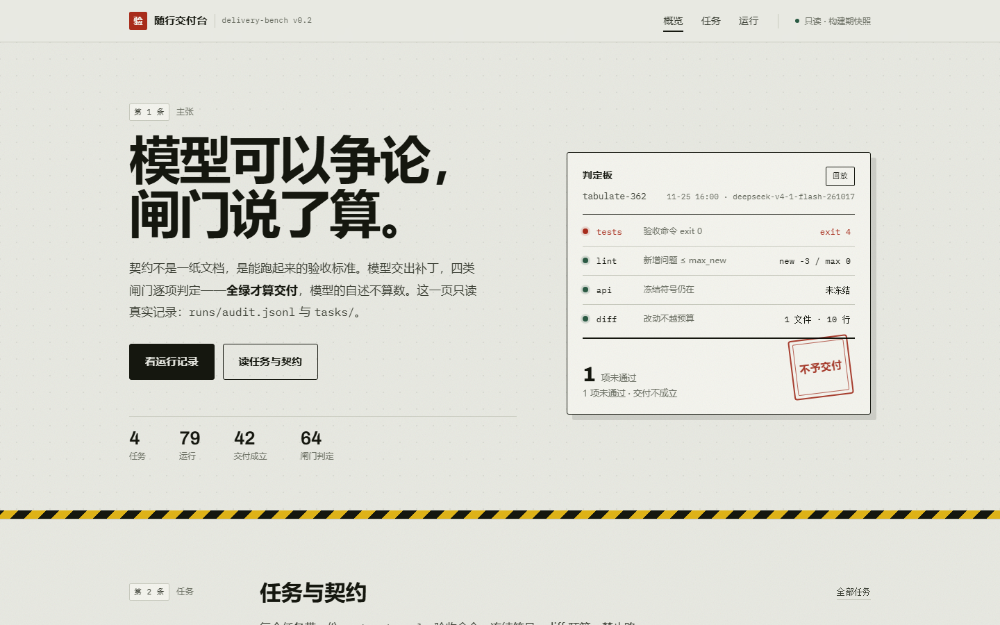

# 随行交付台（delivery-bench）

[](https://github.com/renyiLi/way-mate/actions/workflows/ci.yml)

以**可执行验收契约**为中心的多角色协作代码交付系统。

毕业设计课题：《基于可执行验收契约的多角色协作代码交付系统设计与实现》

核心主张：模型是可替换的工人，**契约是不可替换的裁判**。
模型之间可以争论，但只有闸门能宣布交付成立。

## 当前进度

**v0.2 —— 三层协议已成型，23 条测试全绿，不依赖任何 API Key。**

| 层 | 内容 | 代码 |
|---|---|---|
| 闸门层 | 契约解析 + 四类闸门 + 审计日志 | [contract.py](src/dbw/contract.py) [gates.py](src/dbw/gates.py) [audit.py](src/dbw/audit.py) |
| P0 底层协议 | 能力协商、统一封套、方言归一化、错误分类、降级登记 | [base.py](src/dbw/protocol/base.py) |
| P1 分内接口 | 写作 / 审计 / 协作，各有不变量 | [interfaces.py](src/dbw/protocol/interfaces.py) |
| P2 协议机 | 2 人 / 3 人 / 双轨，同一台状态机 | [machine.py](src/dbw/protocol/machine.py) |

协议规格：[docs/接口协议.md](docs/接口协议.md)

## 快速开始

```powershell
python -m pip install -r requirements-dev.txt

# 1. 先测闸门（不花钱）
python -m pytest -q
python scripts/demo_gate.py

# 2. 再测模型通路（需要 .env 里的密钥）
python scripts/test_connection.py                                   # DeepSeek 官方
python scripts/test_connection.py --provider ark --models a,b,c     # 火山方舟，多模型对比

# 3. 一次真实交付：模型 → 补丁 → 四类闸门
python scripts/run_once.py --provider ark --model kimi-k3-1-pro-261024
```

## 已验证：两个端点、四个模型

同一道题（`fix-parser-inline-comment`），同样的契约，单轮结果：

| 端点 / 模型 | 结果 | 耗时 | token | 是否写明了 `missing '='` |
|---|---|---|---|---|
| deepseek / `deepseek-chat` | ✅ 通过 | 2.1 s | 996 | 是 |
| ark / `kimi-k3-1-pro` | ✅ 通过 | 54.8 s | 2746 | 是 |
| ark / `deepseek-v4-1-flash` | ❌ 失败 | 4.8 s | 1502 | **否** |
| ark / `doubao-seed-2-1-pro` | ❌ 失败 | 155.2 s | 6010 | **否** |

失败原因不是"模型不行"，而是**它把异常消息改写成了中文**（`配置行缺少 '='`），
而契约要求包含 `missing '='`。**四组结果与"是否读成硬约束"100% 相关。**

> 结论：契约必须把精确断言写成显式条目，不能藏在测试输出里让人猜。

**实测能力（2026-11）**：Ark 上三个模型均支持 `json_schema` / `tools` / `seed`；
`kimi-k3-1-pro` 只接受 `temperature=1`（参数取值域限制，需登记降级）；
DeepSeek 官方端点**不支持** `json_schema`，只能走 `json_object` 降级。
明细见 `runs/capabilities.*.json`。

## 成长能力：接口已预留，实现待定

`src/dbw/memory.py` 定义了 `ExperienceStore` / `MemoryHook` 协议，默认是**空实现**——
接入与不接入，系统行为完全一致（30 条测试覆盖）。

一条不可越过的边界：**成长只能改变"怎么干活"，不能改变"什么算干完"。**
系统若有权改验收标准，闸门就从客观裁判退化成自证。

## CI

[`.github/workflows/ci.yml`](.github/workflows/ci.yml)：`ruff check` + 30 条离线测试，矩阵 Python 3.10 / 3.11。
依赖版本钉在 `requirements-dev.txt`，本机与 CI 一致；**不做格式门禁**（不引入 black）。

> **私有仓库注意**：Actions 会消耗账号额度。若账号账单异常，job 不会启动，会报
> `The job was not started because recent account payments have failed...`。
> public 仓库的 standard runner 不限额；否则需在 Settings → Billing 补齐支付方式。

本地等价检查：

```powershell
ruff check src scripts tests
python -m pytest -q
```

## 核心设计：座位固定，人数可变

接口数量 ≠ 流程数量。三个座位是固定的，模型数量只决定"一个模型能不能兼两个座位"：

| 协议 | 排班 | 谁消解分歧 |
|---|---|---|
| `2p.single` | 提案 + 复核 | 只能交给闸门 |
| `3p.single` | 提案 + 复核 + 裁决 | 裁决消解一部分，闸门终裁 |
| `3p.dual` | 双提案 + 裁决 + 复核 | 裁决先选提案，闸门终裁 |

于是 2 人和 3 人是同一台状态机的两种排班，工作量从 6 份降到 1 份。

## 四类闸门

| 闸门 | 判什么 | 防什么 |
|---|---|---|
| `tests` | 验收命令全部退出码 0 | 功能没做对 |
| `lint` | 新增问题 ≤ `max_new`（对比打补丁前基线） | 越改越乱 |
| `api` | 冻结的公开符号仍存在 | 顺手破坏外部接口 |
| `diff` | 文件/行数不超预算，未触碰禁止路径 | 大面积重写、**改测试代替改代码** |

## 三个分内接口

| 接口 | 提案产出 | 复核产出 | 闸门 |
|---|---|---|---|
| 写作 | 补丁（整文件） | 契约违反清单 | 代码闸门 |
| 审计 | 候选问题清单 | 逐条验真（upheld/rejected） | 验真后的结论闸门 |
| 协作 | 任务 DAG | 分解缺陷 | 图合法性闸门 |

接口的"分内协议"= 输出模式 + 不变量 + 禁止事项，不是流程。

## 精确断言：把测试里的硬约束提上来

`pytest.raises(ValueError, match="missing '='")` 里的字符串，模型原本只能从 25 行 traceback 里揣摩，
于是把消息"优化"得更好读，测试就红了。

`exact` 把它提取进契约，写作与复核两个座位都能直接看到：

```yaml
exact:
  - exception: ValueError
    contains: "missing '='"
    source: "tests/test_parser.py:25"
    origin: auto      # auto=自动提取，manual=人工写
```

- 自动提取：`python scripts/extract_exact.py`（AST 扫 `pytest.raises(match=...)`）
- 防漂移：`python scripts/extract_exact.py --check`（已接入 CI）
- `match` 是正则，含元字符的不收——宁可少收，不可错收

### 对照实验（n=3，单任务 fixture）

| 模型 | 无 exact | 有 exact | 平均 token | 平均耗时 |
|---|---|---|---|---|
| `deepseek-chat` | 0/3 | **3/3** | 999 → 1046 | 1.8s → 2.3s |
| `deepseek-v4-1-flash` | 3/3 | 3/3 | 2207 → 2030 | 8.3s → 6.3s |
| `kimi-k3-1-pro` | 3/3 | 3/3 | 5513 → **2308（−58%）** | 110.4s → **46.0s** |

三个结论：

1. **救回**：`deepseek-chat` 从 3 次全红变成 3 次全绿，效应稳定；
2. **省成本**：`kimi` 两条件都通过，但 token 省 58%、耗时省 58%——它不再需要"猜"消息该写什么；
3. **天花效应**：另外两个模型两条件都 3/3，说明这个 fixture 对它们太简单，**单任务无法区分条件**。

> 第 3 条是方法论教训：n=1 时我看到的"4/4 相关"里有大量噪声。
> 第 6 章的实验必须**难度分层**且**每格 ≥3 次**，否则结论站不住。

```yaml
task_id: fix-parser-inline-comment
repo: .
doD:
  tests:
    - cmd: pytest tests/test_parser.py -q
      timeout_s: 120
  lint: {tool: ruff, max_new: 0}
  api:  {frozen: [pkg.parser.parse_kv]}
  diff: {max_files: 5, max_lines: 120, forbid: [tests/]}
loop:
  repair_rounds: 3
  on_exhausted: escalate_to_human
```

## 演示外壳（web/）

`web/` 是一张能盖章的"验收单"：把主张、任务与契约、四类闸门、运行记录摆在同一个版面上。
零构建、零 JS 依赖、字体自托管，`file://` 双击也能看。



```powershell
python web/build-data.py          # 读 tasks/ 与 runs/audit.jsonl，生成 web/data/site.{json,js}
python web/tools/serve_web.py     # 起本地预览并自动开浏览器（自动找空闲端口）
node web/check.mjs                # 回归：起 headless Chrome 跑一组真实交互断言
```

- 设计规范：[web/DESIGN.md](web/DESIGN.md) —— 色板、字体、版式、动效档位、Don'ts 都在里面
- 活样式表：[web/style.html](web/style.html) —— 同一份 `styles.css` 渲染出颜色、字号、组件各状态
- 四个视图，hash 路由，`file://` 也能走完：`#/` 概览 · `#/tasks` 任务 · `#/tasks/<id>` 任务详情 · `#/runs` 运行列表（可按结果筛选）· `#/runs/<id>` 运行详情（闸门逐项 + 事件时间线）
- 首屏判定板会回放**最近一次真实运行**的闸门判定，点「回放」可重放
- 页面数据由 [`web/build-data.py`](web/build-data.py) 在构建期生成，来源是 `tasks/*/task.json` 与 `runs/audit.jsonl`（方案 B）

外壳只负责"看"，不参与判定：页面不发任何请求，也不自己算"是否可交付"——只读 `all_green`。
要让壳显示真实运行结果，应当由脚本把 `GateReport` 导出成 JSON 再替换常量，而不是在页面里重算一遍规则。

## 目录

```
src/dbw/
  contract.py            契约 DSL 解析与严格校验
  gates.py               四类闸门
  audit.py               append-only JSONL 审计
  protocol/
    envelope.py          座位 / 阶段 / 封套 / 预算
    base.py              P0 底层三方协议
    interfaces.py        P1 三个分内接口
    machine.py           P2 协议机
fixtures/repo_a/         示例仓库（带 bug 与契约）
scripts/demo_gate.py     闸门端到端演示
web/                     演示外壳（静态页 + 构建期数据 + 自托管字体）
web/tools/serve_web.py   预览用静态服务器
web/check.mjs            外壳回归脚本（CDP 驱动 headless Chrome）
docs/                    开题报告 / 排期 / 接口协议
runs/audit.jsonl         运行审计（不入库）
```

## 下一步（W2）

1. `adapters/openai_compat.py`：DeepSeek + Kimi 共用一个适配器（都是 OpenAI 兼容）
2. 真实评估器：把补丁写进工作区 → 跑四类闸门 → 返回 `GateReport`
3. 接一条真实 bug，跑通「模型产出 → 闸门判定」

## 注意

- 目标仓库必须自带 `pytest.ini` 与 `ruff.toml`，否则会继承上层配置，判定不可复现。
- Windows 终端中文乱码时先 `chcp 65001` 或设 `PYTHONUTF8=1`。
